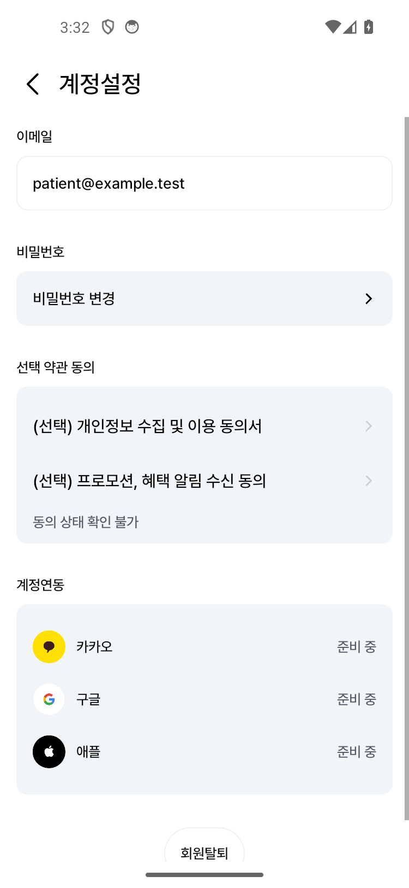
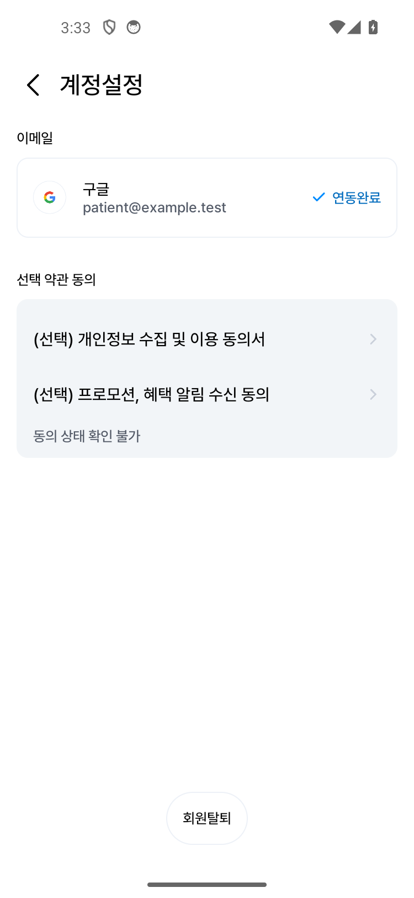
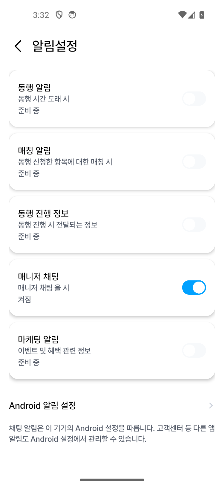

# 계정·알림 설정 상세

일반 회원(환자·보호자)과 매니저의 설정에서 계정·알림 상세 화면을 연다. 실제 로그인 방식에 따라 이메일 계정과 소셜 계정의 표시를 구분하고, 기존 비밀번호 재설정 메일과 Android 채팅 알림 설정을 연결했다.

| 이메일 계정 | 소셜 계정 | 알림 설정 |
| --- | --- | --- |
|  |  |  |

위 캡처는 API 34 에뮬레이터의 실제 Activity에 합성 계정·알림 상태를 주입한 결과다. 실계정이나 실서버의 동의·구독 상태를 나타내지 않는다. 아래 결과는 `dev`의 `e8e943c2`에서 분기한 작업 브랜치에서 검증한 기록이다. 실기기나 배포 환경에서 확인한 결과는 아니다.

## 디자인과 동작

- 완성본의 [설정 진입](https://www.figma.com/design/fqwi44prjEgVFZhaM6LuzS?node-id=1-3382), [이메일 계정](https://www.figma.com/design/fqwi44prjEgVFZhaM6LuzS?node-id=1-3404), [소셜 계정](https://www.figma.com/design/fqwi44prjEgVFZhaM6LuzS?node-id=1-3590), [알림 설정](https://www.figma.com/design/fqwi44prjEgVFZhaM6LuzS?node-id=1-4204)을 읽기 전용으로 확인했다. 파일은 `fqwi44prjEgVFZhaM6LuzS`, `보들 어플 완성본`이다.
- 60dp 헤더, 15dp 좌우 여백, 계정 항목 순서, 회색 그룹과 알림 카드, 원본 스위치를 반영했다. 뒤로가기·소셜 로고·확인 표시·화살표는 원본과 일치하는 기존 자산을 재사용하고 스위치 2개만 PNG로 추가했다. 30dp 뒤로가기와 40×24dp 스위치의 터치 영역은 각각 48dp 이상이다.
- 장식용 상태바는 복제하지 않고 Android 상태바·내비게이션 인셋을 따른다. 글자 색에는 기존에 승인한 대비 보완 토큰을 적용했다. 큰 글자는 줄바꿈·스크롤로 처리하며 글자 크기를 임의로 줄이지 않는다.
- 이메일·로그인 방식은 화면 진입 때 실제 인증 계정을 다시 조회한다. Firebase의 연결 제공자 정보를 우선하고, 기존 커스텀 로그인은 UID 접두어와 본인 프로필의 제공자가 모두 일치할 때만 카카오·네이버로 표시한다. 이메일 주소가 있다는 이유만으로 비밀번호 계정이나 소셜 연동을 추정하지 않는다.
- 비밀번호 변경은 기존 재설정 메일 방식이다. 확인창을 연 UID·이메일과 발송 직전의 계정을 대조한다. 취소 시 발송하지 않으며, 발송 중 화면 재생성·연속 선택으로 중복 요청하지 않는다. 실패 시 다시 시도할 수 있다.
- 채팅 스위치는 이 기기의 앱 알림 허용 여부와 기존 `companionChatUpdates` 채널 상태를 읽는다. 누르면 Android 채널 설정 또는 앱 알림 설정을 열고 복귀 시 다시 조회한다. 누르는 순간 UI만 반전하거나 기존 채널의 사용자 설정을 덮어쓰지 않는다.
- 고객센터·위치 알림과 기존 예약 리마인더 코드·발송 경로는 변경하지 않았다. 전체 Android 알림 설정 진입도 유지한다. 마이페이지의 건강정보·본인인증 안내·서류·이력·문의·로그아웃 경로는 그대로다.

## 아직 연결하지 않은 항목

| 항목 | 현재 표시와 처리 |
| --- | --- |
| 선택 약관 2종 | 동의 상태를 확인할 계약이 없어 체크 표시 대신 `동의 상태 확인 불가`를 표시한다. 누르면 안내만 열며 동의·철회로 저장하지 않는다. |
| 추가 계정 연동·해제 | 실제 연결된 제공자만 `연동완료`, 나머지는 `준비 중`이다. 기존 로그인 기능으로 다른 계정에 로그인하거나 계정을 합치지 않는다. |
| 회원탈퇴 | 미지원 안내 뒤 역할에 맞는 고객센터로 이동한다. 계정·예약 삭제나 로그아웃을 실행하지 않는다. |
| 동행·매칭·진행·마케팅 알림의 항목별 설정 | `준비 중`과 비활성 형태를 표시하고 안내만 연다. 화면의 꺼진 모양을 서버 구독 거부로 취급하지 않으며 기존 알림 동작을 변경하지 않는다. |

## 설계 판단

- 작업 목적: 설정의 계정 팝업과 Android 알림 설정 바로가기를 완성본의 상세 화면으로 연결한다.
- 선택한 방식: 완성본의 정보 순서와 자산을 사용하고 실제 인증 계정 정보·비밀번호 재설정 메일·Android 채팅 알림 채널을 연결한다. 동의·계정 연동·탈퇴·미지원 알림은 실제 변경이 없음을 구분한다.
- 대안: 화면 상태만 저장하는 가짜 스위치, 기존 로그인 API로 계정을 합치는 우회, 서버 설정 API까지 한 번에 추가하는 방식을 검토했다.
- 선택 이유: 현재 앱에는 이 화면의 항목별 알림 구독·선택 동의·계정 통합 계약이 없다. 기존 인증과 알림 기능을 유지하면서 새 화면을 검증하고, 저장 계약이 필요한 기능을 분리하는 편이 변경 영향을 제한한다.
- 리스크: 화면 반영은 전체 계정 관리·서버 알림 구독 구현 완료가 아니다. Android 채널 설정은 기기 단위이며, 계정별·기기 간 구독 동기화가 아니다.

## 변경 범위

- `SettingsDetailActivity`는 인증·재조회·로딩/오류·뒤로가기만 공유하고, 계정·알림의 표시와 이벤트는 각각 Activity/Binder로 나눴다. 비밀번호 발송 중 상태는 ViewModel에 두고, 외부 인증 조회와 Android 설정 접근은 Repository에 둔다.
- 화면이 정지되면 개인 정보·대화상자를 비운다. 이전 조회 응답이나 계정 변경 전 발송 결과로 새 화면을 덮어쓰지 않으며, 프로필 미완료 사용자는 기존 보완 화면으로 이동한다. 두 상세 Activity는 외부에 공개하지 않는다.
- Android 코드·리소스·debug 검증 화면·테스트와 이 설계 문서만 변경했다. 관리자 웹, Core API, Firebase Rules/Functions, DB, 운영 설정, 의존성·SDK 버전과 Figma 원본은 변경하지 않았다.

## 검증

| 환경 | 확인 결과 |
| --- | --- |
| Debug 앱·계측 APK, Release App Check | `assembleDebug testDebugUnitTest assembleDebugAndroidTest :app:verifyReleaseAppCheckClasspath` 통과 |
| 단위 테스트 | 547건 통과, 실패·오류·건너뜀 0건. 실제 제공자 판별·UID/이메일 대조 8건 추가 |
| 개발·운영 환경 경계 | `node tools/android/check-environment-boundary.mjs`의 API/Realtime 혼합 차단 4건 통과 |
| API 34, 375×812dp·100%·제스처 | 상세 24건, 기존 마이페이지 19건, FAQ 4건, 고객센터 13건, 총 60건 통과 |
| API 30, 360×640dp·100%·3버튼 | 상세 24건과 마이페이지 19건, 총 43건 통과 |
| API 34, 412×892dp·130%·제스처 | 상세 24건 통과 |
| API 30, 360×640dp·200%·3버튼 | 상세 24건 통과. 탈퇴 안내 버튼이 잘리던 문제를 한국어·짧은 명령 문구로 보완한 뒤 취소와 역할별 문의 이동 재검증 |
| Lint | 기존 `NewApi` 오류 35건으로 전체 실패. 직전 FAQ 보고서와 오류 종류·메시지·파일·줄 차이 0건. 새 상세 레이아웃의 `wrap_content`+`weight` 측정 경고 1건은 남아 있으며 오류는 없음 |

계측에는 실제 설정 메뉴 왕복, 이메일·소셜·알 수 없는 제공자, 읽기 실패·재시도, 인증/계정 변경·지연 응답, 메일 취소·중복 발송·재생성·오류 복구, 미지원 동작의 쓰기 차단, 알림 설정 복귀·열기 실패를 포함했다. 합성 저장소로 화면 동작을 검사하는 테스트와 실제 에뮬레이터의 Android 권한·기존 채널을 읽는 검사를 구분했다. 원본 스위치·로고의 비어 있지 않은 픽셀, 화살표 방향, 터치 영역과 긴 이메일·확대 글자의 줄 잘림도 검사했다. 화면 크기별 실행은 같은 테스트의 재실행이며 서로 다른 테스트 수로 합산하지 않는다.

이 작업 폴더에는 개발 Firebase 설정이 없어 Mock/CI fallback으로 빌드했다. 실제 Firebase 계정 조회·재설정 메일 수신·FCM 수신과 실기기 종단 검증을 완료한 것은 아니다. 검증 로그·추가 캡처는 무시되는 `.tmp/account-notifications/`에 두었다.

## 남은 범위

- 직접 새 비밀번호 입력·재인증, 선택 약관 원문·동의 이력, 계정 연동/해제와 실제 탈퇴 처리.
- 원본의 네 알림 분류를 실제 발송 경로와 연결하는 항목별 구독 계약, 마케팅 동의·발송. 기존 예약 리마인더와 위치 알림의 의미를 확인한 뒤 연결해야 하며 UI만으로 대체하지 않는다.
- 실제 개발 계정의 메일 수신·푸시 수신과 실기기 왕복. 운영 설정·서버·DB·의존성은 변경하지 않는다.
