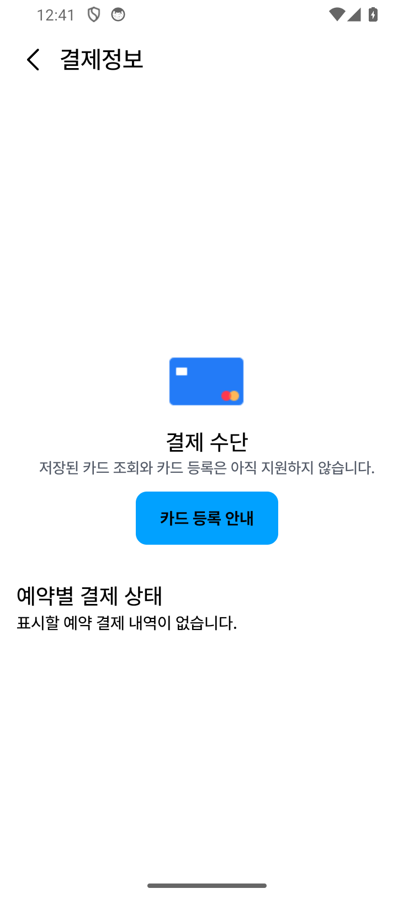
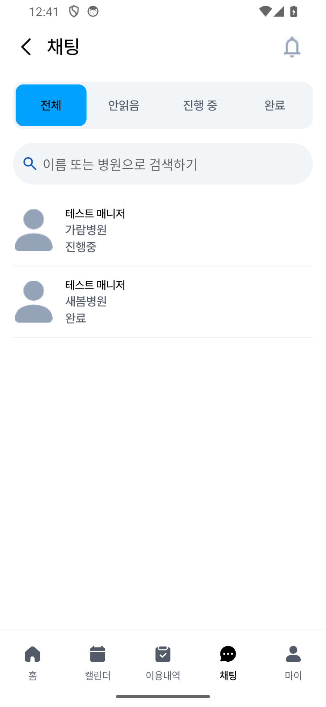
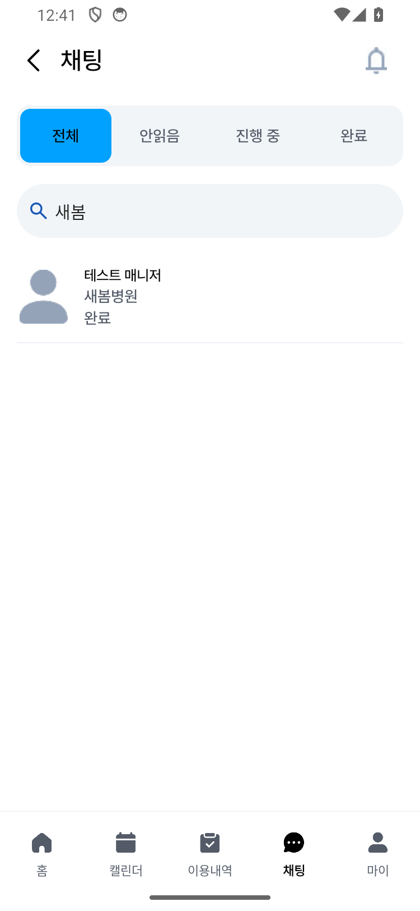
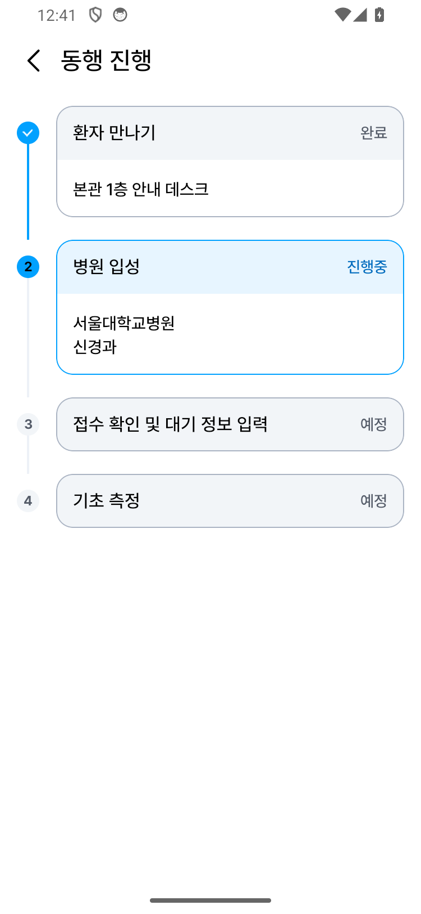

# 결제정보·채팅 목록·동행 현황·마이페이지 상세

기준: [보들 어플 완성본](https://www.figma.com/design/fqwi44prjEgVFZhaM6LuzS), Android 개발 브랜치. 이 문서는 서버 배포나 운영 계정 검증 기록이 아니다.

| 화면 | 진입과 실제 동작 | 표시하지 않는 것 |
| --- | --- | --- |
| [결제정보](https://www.figma.com/design/fqwi44prjEgVFZhaM6LuzS?node-id=1-3996) | 마이페이지에서 환자 본인의 예약별 결제 수단·상태와 알려진 금액을 확인하고 해당 예약으로 이동한다. 빈 결과, 조회 실패, 환자 외 계정을 구분한다. | 등록 카드 목록·번호 입력·실승인·PG 거래 영수증. 카드 등록 버튼은 안내만 연다. |
| [채팅 목록](https://www.figma.com/design/fqwi44prjEgVFZhaM6LuzS?node-id=1-9194) · [검색](https://www.figma.com/design/fqwi44prjEgVFZhaM6LuzS?node-id=1-9335) | 하단 채팅 탭에서 예약 상태로 좁히거나 병원·상대 이름으로 검색한다. 매니저는 현재 배정만, 보호자는 공유받은 매칭·진행 예약의 병원만 검색한다. 선택한 예약 ID로 기존 채팅 상세가 다시 인가한다. | 예약 요약에 없는 메시지 미리보기·안읽음 개수·읽은 시각. 과거 매니저 대화방은 검색되지 않는다. |
| [동행 진행](https://www.figma.com/design/fqwi44prjEgVFZhaM6LuzS?node-id=1-17873) | 예약 상세의 동행 현황과 채팅 상세에서 열린다. 환자·보호자는 해당 예약의 가이드 단계와 현재 상태를 조회한다. 완료 예약에 실제 리포트가 있을 때 기존 리포트를 연다. | 단계 입력·완료, 매니저 내부 일지, 시안의 예시 수치 및 예측 시간 |
| [프로필 편집](https://www.figma.com/design/fqwi44prjEgVFZhaM6LuzS?node-id=1-4286) · [앱 버전](https://www.figma.com/design/fqwi44prjEgVFZhaM6LuzS?node-id=1-5102) | 로그인 사용자의 이름·계정정보, 환자·보호자의 건강정보 경로를 유지한다. 버전은 설치된 빌드에서 읽는다. | 사용자 이름·사진 임의 저장, 역할 변경, 확인하지 않은 업데이트 상태 |
| [공지사항](https://www.figma.com/design/fqwi44prjEgVFZhaM6LuzS?node-id=1-4912) · [약관](https://www.figma.com/design/fqwi44prjEgVFZhaM6LuzS?node-id=1-5072) | 공지 필터와 약관 종류 선택, 고객센터 연결을 제공한다. 일반 사용자에게는 기존 홈 이용 안내를 공식 공지와 구분해서 보여준다. | 게시되지 않은 공지·날짜, 시안에 들어 있는 약관 예문, 법적 동의 기록 |

## 설계 판단

- **목적·방식:** 이미 있는 읽기 계약으로 가능한 화면을 하나의 PR에 묶되 예약·결제·대화 상세는 재사용한다. 화면을 닫으면 개인 데이터와 구독을 비우고, 재진입 시 인증을 다시 확인한다.
- **대안·선택 이유:** 목록의 모든 예약마다 메시지·첨부를 미리 조회하면 원문 접근과 호출 수가 늘어난다. 예약 요약만 표시하고 실제 열람·읽음 처리는 사용자가 선택한 방에서만 한다. [종료 후 접근과 동의 범위](../architecture/companion-session-core-api.md)도 그대로다.
- **리스크:** 매니저의 돌봄 종료는 상태뿐 아니라 최초 종료 시각도 확인한다. 진행 단계를 서버 코드와 맞출 수 없으면 완료로 추정하지 않는다. 보호자 권한이 회수되거나 조회가 실패하면 이전 내용을 지우며, 검색으로 다른 예약의 권한을 얻을 수 없다.

## 화면 확인

Android 에뮬레이터에서 합성 예약으로 촬영한 앱 화면이다. 시안 이미지나 실제 사용자 데이터가 아니다.

| 결제정보 | 채팅 목록 | 채팅 검색 | 동행 진행 |
| --- | --- | --- | --- |
|  |  |  |  |

[프로필 편집](assets/detail-batch/standard-profile.png) · [공지사항](assets/detail-batch/standard-notices.png) · [이용약관](assets/detail-batch/standard-terms.png) · [설치 버전](assets/detail-batch/standard-version.png)

## 검증

- 개발용 Firebase 설정 없이 Debug 앱·계측 APK를 빌드했다. 단위 테스트 557건을 통과했다(실패·오류·건너뜀 0건).
- 릴리스 App Check 의존성 검사와 개발·운영 Core API 및 Realtime 주소의 교차 주입 차단 4건을 통과했다.
- 예약 ID가 다르면 동행 현황·최종 리포트를 열지 않는지, 보호자 공유 권한을 잃은 뒤 예전 응답이 도착해도 내용을 다시 표시하지 않는지, 목록 검색만으로 메시지가 읽음 처리되지 않는지를 합성 데이터로 확인했다.
- Android 14(API 34, 375×812dp, 글꼴 100%)에서 홈·예약·채팅·마이페이지를 포함한 계측 테스트 149건을 통과했다. 실제 시스템 키보드를 열고 닫은 후 입력란과 하단 탭으로 돌아오는 흐름도 포함한다.
- Android 11(API 30, 360×640dp, 글꼴 130%)에서 새 상세 화면과 예약 진입 테스트 11건을 통과했다. [채팅 검색](assets/detail-batch/small-search.png) · [동행 현황](assets/detail-batch/small-progress.png) · [프로필 편집](assets/detail-batch/small-profile.png)
- 전체 Android Lint는 기존 `NewApi` 오류 35건 때문에 실패한다. #539 기준 결과와 오류의 파일·줄·메시지가 모두 같았고, 경고는 614건에서 610건으로 줄었다.

## 후속 범위

카드 보관·자동결제·출금, 읽음 요약 API, 공식 공지와 버전별 약관 발행, 본인확인 후 프로필 변경은 별도 계약이 필요하다. 기존 예약 시각·평점 모델, 지급 정책, 앱 권한, 서버·DB·의존성은 이번 작업에서 바꾸지 않는다.
