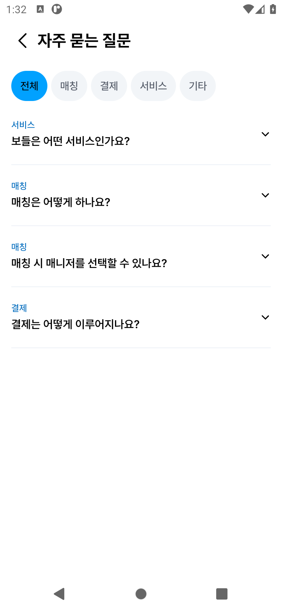
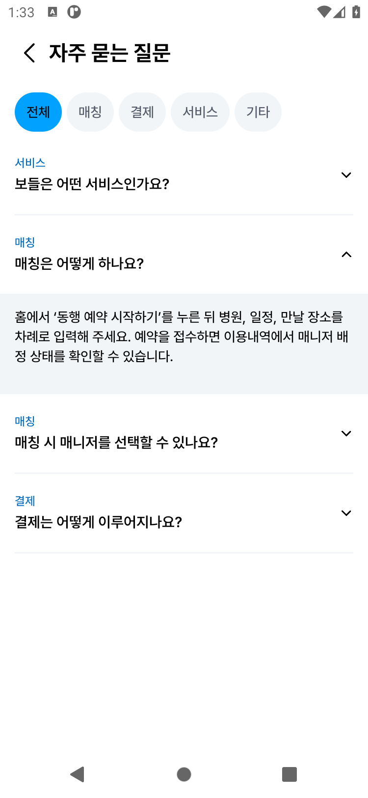

# 자주 묻는 질문

마이페이지의 ‘자주 묻는 질문’을 누르면 준비 중 안내 대신 실제 목록이 열린다. 일반 회원(환자·보호자)과 매니저가 같은 내용을 보며, 뒤로 가면 자신이 열었던 마이페이지로 돌아간다. 기존 고객센터 메뉴는 역할에 맞는 문의 목록과 작성 화면을 그대로 연다.

| 목록 | 답변 펼침 |
| --- | --- |
|  |  |

## 디자인과 동작

- 완성본의 [목록](https://www.figma.com/design/fqwi44prjEgVFZhaM6LuzS?node-id=1-4992)과 [펼친 상태](https://www.figma.com/design/fqwi44prjEgVFZhaM6LuzS?node-id=1-5136)를 기준으로 했다. 대응 프레임 `1:5032`, `1:5177`의 질문·분류·답변도 동일하다.
- 전체·매칭·결제·서비스·기타 순서로 분류한다. 한 번에 답변 하나를 열고, 다시 누르면 닫는다. 다른 분류를 선택해도 해당 질문이 그 분류에 속하면 열린 상태를 유지한다. 기타에는 원본 질문이 없으므로 빈 상태를 표시한다.
- 원본 뒤로가기(30dp)와 펼침 화살표(14dp)는 기존 자산과 같은 모양이라 재사용했다. 시스템 상태바 장식은 복제하지 않는다. 선택 칩은 브랜드 배경색을 유지하고, 글자에는 기존 대비 보완 토큰을 적용했다. 큰 글자에서는 분류는 가로로, 질문과 답변은 세로로 스크롤한다.
- 원본에 답변 예시가 있는 항목은 ‘매칭은 어떻게 하나요?’ 하나다. 사용자가 실제 버튼을 찾을 수 있게 ‘홈에서 동행 예약 시작하기’로 안내했다. 나머지 세 답변은 현재 서비스·매니저 배정·결제 확인 흐름을 설명한다. 매니저 직접 선택이나 실제 자동결제를 약속하지 않는다.

## 설계 판단

- **목적:** 기존 마이페이지·문의 기능을 바꾸지 않고 정해진 질문을 오프라인에서도 찾아볼 수 있게 한다.
- **방식과 이유:** 문구는 Android 리소스, 분류·펼침은 화면 상태로 분리한다. 네 개의 공통 질문을 읽는 데 계정 조회나 저장소 연결이 필요하지 않다. 화면 재생성 시에는 계정 정보 없이 분류와 질문 이름만 복원한다.
- **대안과 리스크:** 관리자 웹에서 편집하는 FAQ API도 가능하지만, 현재는 발행·버전 계약이 없다. 앱 내 답변은 운영 절차가 바뀌면 함께 갱신해야 한다. 즉시 발행이나 역할별 콘텐츠가 필요해지면 별도로 검토한다.

## 검증

| 환경 | 확인 결과 |
| --- | --- |
| Debug 앱·계측 APK, Release App Check, 환경 경계 | 빌드와 의존성 검사 통과. 개발·운영 API/Realtime 혼합 차단 4건 통과 |
| 단위 테스트 | 539건 통과. 분류·단일 펼침·숨은 항목 차단·이전 상태 복원 5건 포함 |
| API 30, 375dp·글자 100%·3버튼 | FAQ 4건, 마이페이지 19건, 기존 고객센터 13건 통과 |
| 같은 에뮬레이터, 360dp·200%·3버튼 및 412dp·130%·제스처 | 각 환경에서 FAQ 4건과 환자·보호자·매니저의 실제 FAQ 왕복 1건 통과 |
| Lint | 전체는 기존 `NewApi` 오류 35건으로 실패. 직전 서류 작업 보고서와 오류 종류·메시지·파일·줄 차이 0건, FAQ 파일 지적 0건 |

분류별 질문과 빈 상태, 답변 전환·재선택, 화면 재생성, 툴바·시스템 뒤로가기, 확대 글자의 줄 배치와 선택 칩 대비를 검사했다. 고객센터의 실제 IME 검사는 에뮬레이터 소프트 키보드 표시를 켜고 재실행했다. 위 캡처는 실제 FAQ Activity이며 마이페이지·문의 회귀는 합성 계정을 사용했다. 실기기·실계정 종단 검증, 서버·DB·Figma 원본 변경 및 운영 배포는 하지 않았다.
