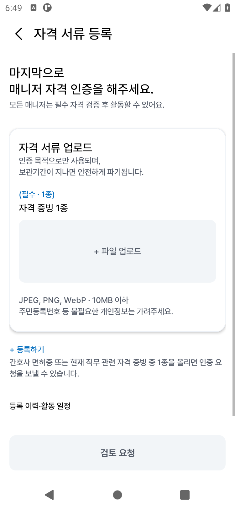
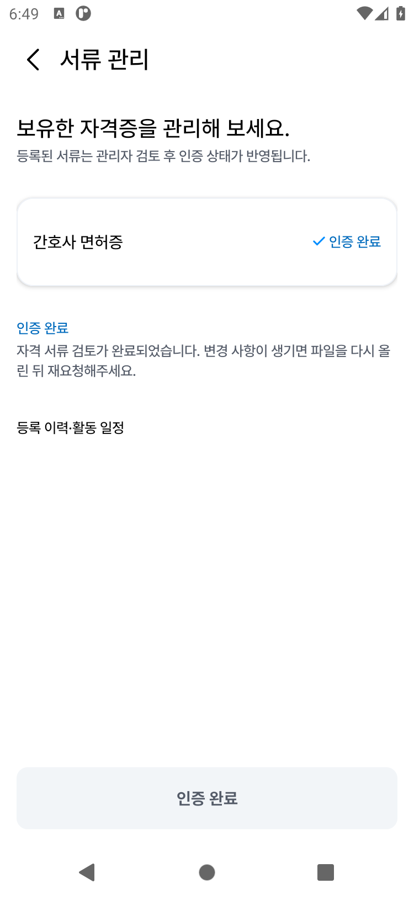
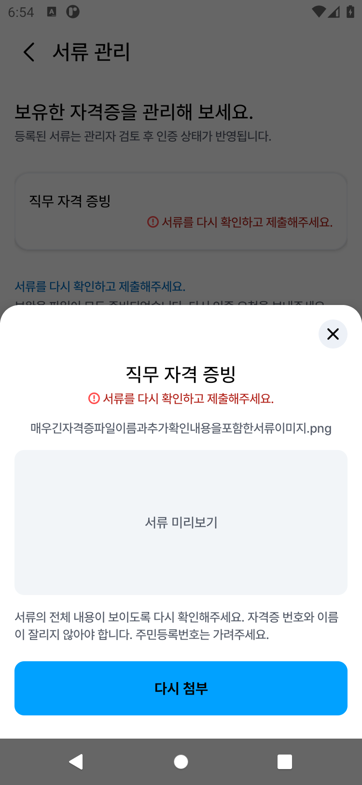

# 매니저 서류 등록·관리 Figma 반영

기준일: 2026-11-17. 작업 기준: `dev`의 `1837fdad`.

## 설계 판단

- 작업 목적: 고객센터 다음 범위인 매니저 서류 등록·관리 화면을 완성본의 정보 밀도와 상태 표시로 전환한다.
- 선택한 방식: 등록·관리 진입점을 같은 서류 화면과 기존 Coordinator/Repository/ViewModel에 연결하고, 실제 파일과 심사 상태로 목록·상세를 그린다.
- 대안: 서류마다 별도 저장·심사 API를 만들거나 시안의 예시 파일을 표시하는 방식은 이번 UI 작업에 포함하지 않는다.
- 선택 이유: 현재 한 종류의 자격 증빙을 검토하는 계약을 유지하면 저장·재심사 호환성과 운영 부담을 지키면서 화면을 단계적으로 교체할 수 있다.
- 리스크: 완성본의 여러 선택 서류·개별 심사·삭제는 후속 데이터 계약이 필요하다. UI 적용만으로 해당 기능까지 완료됐다고 보지 않는다.

## 기준 원본

Figma file: `fqwi44prjEgVFZhaM6LuzS`.

| 화면 | Node |
| --- | --- |
| 자격 서류 등록 | [1:14617](https://www.figma.com/design/fqwi44prjEgVFZhaM6LuzS?node-id=1-14617) |
| 서류 관리 상태·미등록 | [1:16861](https://www.figma.com/design/fqwi44prjEgVFZhaM6LuzS?node-id=1-16861), [1:16892](https://www.figma.com/design/fqwi44prjEgVFZhaM6LuzS?node-id=1-16892) |
| 인증 완료·보완 요청 상세 | [1:17828](https://www.figma.com/design/fqwi44prjEgVFZhaM6LuzS?node-id=1-17828), [1:17856](https://www.figma.com/design/fqwi44prjEgVFZhaM6LuzS?node-id=1-17856) |

## 보존 경계

- `LICENSE` 또는 `NURSING_LICENSE` 1종, JPEG/PNG/WebP·10MB 제한과 저장소 검증을 유지한다. 신분증·범죄경력 서류는 수집하지 않는다.
- 기존 `HEALTH_CERTIFICATE`는 읽기 호환만 유지하고 새 검토에는 적합한 자격 증빙으로 교체해야 한다.
- 업로드 초안 저장과 최종 검토 요청을 구분한다. 검토 중·승인·보완 요청은 서버 상태이며 화면에서 승인을 만들지 않는다.
- 원본 증빙 이미지는 예시로 대체하지 않는다. 민감한 원본 열기는 기존 인증된 미리보기 경로를 유지한다.
- 기존 등록 이력·활동 일정 화면은 관리 화면에서 계속 접근할 수 있게 한다.
- Core API, 관리자 웹, Firebase Rules/Storage, DB 계약과 의존성 버전은 변경하지 않는다.

## 구현 범위

| 진입·상태 | 구현 |
| --- | --- |
| 매니저 홈의 자격 서류 등록 | 완성본의 제목·안내·파일 카드·하단 검토 요청, 허용된 자격 유형 선택 |
| 마이페이지의 서류 관리 | 실제 등록 파일의 이름과 미등록·제출 전·검토 중·인증 완료·보완 요청 표시 |
| 서류 상세 | 현재 파일명·검토 상태·보완 메모, 기존 권한 확인을 거치는 외부 미리보기, 파일 재첨부 |
| 오류·재시도 | 조회 실패, 비매니저 접근, 업로드·초안 저장·검토 요청 실패를 구분하며 성공 상태를 만들지 않음 |
| 재생성·계정 변경 | 선택 유형 복원, 중복 업로드/제출 차단, 정지된 화면의 늦은 조회 무시, 작업 소유자가 다른 완료 이벤트 폐기 |
| 접근성 | 시스템 영역 여백, 48dp 터치 영역, 상태 안내 줄바꿈, 비활성 버튼 대비, 긴 파일명·검토 메모 스크롤 |

서류 상태는 `ManagerDocumentDisplayState`에서 파일 유효성과 실제 검토 상태를 함께 확인한다. 새 UI의 Binder와 상세 시트는 이 결과를 표시하며 Repository의 저장·인가 로직은 바꾸지 않는다. 기존 완료 팝업은 기능을 유지하고 200% 글꼴에서 확인 버튼이 잘리지 않도록 가변 높이·스크롤만 보완했다.

체크·경고·닫기 아이콘은 각각 Figma `1:12524`, `1:17112`, `1:12461`의 경로·좌표·색을 Android VectorDrawable로 옮겼다. 원본 PNG export에 평탄화된 회색 배경이 포함돼 있었으므로 원본 벡터 경로를 사용했다. 뒤로 가기와 Pretendard·색상 토큰은 기존 공통 자산을 재사용한다. 민감한 증빙 예시 이미지는 앱에 포함하지 않는다.

## 검증

JDK 21, Android API 30 에뮬레이터, Firebase 설정이 없는 Mock/CI 빌드에서 실행했다. 계측은 실제 Activity에 합성 Repository를 주입하며 파일 선택 결과와 외부 미리보기 실행을 테스트에서 대체한다.

| 검증 | 결과 |
| --- | --- |
| `assembleDebug`, `assembleDebugAndroidTest` | 통과 |
| `testDebugUnitTest` | 534건 통과. 표시 상태 8건과 복원 소유자 경계 2건 추가 |
| `:app:verifyReleaseAppCheckClasspath` | 통과 |
| `node tools/android/check-environment-boundary.mjs` | 개발·운영 API/Realtime 경계 4건 통과 |
| `ManagerDocumentsFigmaTest`, 375dp·100%·3버튼 | 13건 통과 |
| 같은 서류 테스트, 360dp·200%·3버튼 | 13건 통과 |
| 같은 서류 테스트, 412dp·130%·제스처 | 13건 통과 |
| `ProfileFigmaTest`, `ManagerHomeFigmaPreviewTest`, 375dp·100% | 각각 18건·19건 통과 |
| `lintDebug` | 기존 `NewApi` 오류 35건으로 실패. 직전 고객센터 작업 보고서와 오류 종류·메시지·파일·줄 대조 차이 0건 |
| `git diff --check` | 통과 |

정상·빈 파일·4개 검토 상태, 파일 선택 취소/재생성, 중복 결과/제출, 업로드/초안/검토 오류, 구형 파일 교체, 비매니저 접근, 선택 중 계정 변경과 정지 후 늦은 조회를 확인했다. 캡처와 TextView 실제 줄 배치로 긴 파일명·보완 메모·버튼의 잘림을 검사했다. 초기 200% 검사에서 기존 완료 버튼 글자 잘림을 발견해 수정한 뒤 세 표시 조건을 다시 확인했다. Lint 경고 중 이 화면의 배경 중복 그리기와 사용하지 않게 된 구형 행 레이아웃은 남아 있다.

11월 18일에는 파일이 없는 계정에서도 과거 승인 상태 때문에 본문에 ‘검토 완료’가 뜨는 문제를 재현했다. 등록·관리 화면 모두 제목과 본문을 같은 표시 상태에서 가져오도록 수정했다. 서버 상태가 승인·검토 중이어도 파일이 없으면 등록을, 구형 파일만 있거나 두 종류가 함께 있으면 교체를 안내하며 검토 요청 버튼은 비활성화된다. 유효한 파일 한 종류가 있으면 기존 네 가지 검토 상태의 본문을 유지한다.

### 화면 증적

모두 합성 계정·파일명으로 만든 에뮬레이터 화면이다. 실제 증빙 원본이나 개인 계정 정보는 포함하지 않는다.

| 등록 | 관리 | 보완 요청 상세 |
| --- | --- | --- |
|  |  |  |

## 남은 범위

- 완성본의 여러 자격증 동시 등록·서류별 심사/삭제와 상세 내 원본 이미지 표시. 이번에는 실제 파일의 인증된 외부 미리보기를 유지한다.
- 본인인증을 전제로 하는 이름 변경과 다른 계정 상세 화면.
- 실기기 파일 선택기, 실제 개발 서버 업로드·원본 열기·관리자 검토까지의 종단 검증. 연결된 실기기가 없어 이번에는 수행하지 않았다.
- `dev` 병합과 배포. 이 문서는 `codex/figma-final-manager-documents`의 구현·검증 기록이며, 실제 반영 여부는 해당 PR의 병합 상태를 따른다.
